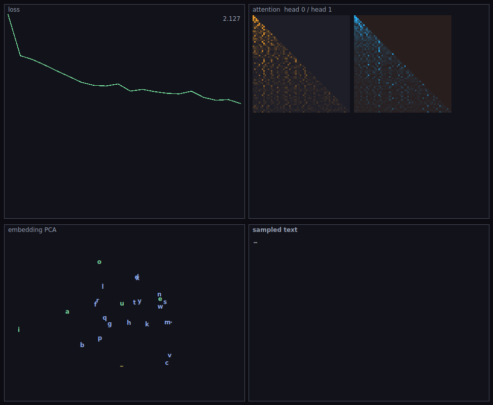

# HandmadeGPT

A character-level GPT trained live in front of you — forward pass, backward
pass and Adam all written by hand in C++. No ML frameworks, no autograd, no
BLAS. Watch the loss fall, the attention heads specialize, the character
embeddings organize themselves, and the sampled text go from noise to words.



## Model

One pre-LN transformer block, ~57k parameters:

- character embeddings + learned positional embeddings
- 2-head causal self-attention (d = 64, head dim 32, context 64)
- GELU MLP (hidden 256), residual connections, three layer norms
- untied unembedding, cross-entropy over all 64 positions (each window is
  65 tokens, so the last position has a target too — it is the one the
  sampler reads)

The backward pass is exact: softmax-attention backprop through the causal
mask, layer-norm gradients, GELU derivative (tanh approximation), the lot.
Training parallelizes over the batch: a persistent worker pool with one
gradient buffer and one activation set per thread, reduced before the Adam
step. A training step allocates nothing.

## Visualization

Four live panels: the loss curve; both attention maps (context × context,
lower-triangular — early in training they are diffuse, then structure
appears); a PCA of the character embedding matrix (top-2 components by power
iteration — vowels, consonants and the space character drift into their own
regions); and text sampled from the model every ~80 steps.

Ships with a small built-in corpus (original text, deliberately plain and
repetitive so a char model learns fast) and a "Load text file"
button to train on anything else. Steps/frame 0 pauses training.

## Layout

```
src/Corpus.h       built-in training text
src/Model.*        parameters, activations, forward, backward, Adam, sampling (no Qt)
src/Trainer.*      batches, worker pool, gradient reduction, statistics (no Qt)
src/Canvas.*       the four panels
src/MainWindow.*   parameter panel and the training timer
src/main.cpp       application entry point
```

## Build

```
cmake -B build -DCMAKE_BUILD_TYPE=Release
cmake --build build -j
```

Requires Qt6 and a C++23 compiler (MSVC 2022+, GCC 13+, Clang 16+). Qt6
Widgets only.

## License

MIT License

Copyright (c) 2026 Mykhailo Makarov

Permission is hereby granted, free of charge, to any person obtaining a copy
of this software and associated documentation files (the "Software"), to deal
in the Software without restriction, including without limitation the rights
to use, copy, modify, merge, publish, distribute, sublicense, and/or sell
copies of the Software, and to permit persons to whom the Software is
furnished to do so, subject to the following conditions:

The above copyright notice and this permission notice shall be included in all
copies or substantial portions of the Software.

THE SOFTWARE IS PROVIDED "AS IS", WITHOUT WARRANTY OF ANY KIND, EXPRESS OR
IMPLIED, INCLUDING BUT NOT LIMITED TO THE WARRANTIES OF MERCHANTABILITY,
FITNESS FOR A PARTICULAR PURPOSE AND NONINFRINGEMENT. IN NO EVENT SHALL THE
AUTHORS OR COPYRIGHT HOLDERS BE LIABLE FOR ANY CLAIM, DAMAGES OR OTHER
LIABILITY, WHETHER IN AN ACTION OF CONTRACT, TORT OR OTHERWISE, ARISING FROM,
OUT OF OR IN CONNECTION WITH THE SOFTWARE OR THE USE OR OTHER DEALINGS IN THE
SOFTWARE.

## Support

If you found this project interesting or useful, you can support my work:

[](https://github.com/sponsors/makarov-mm)
